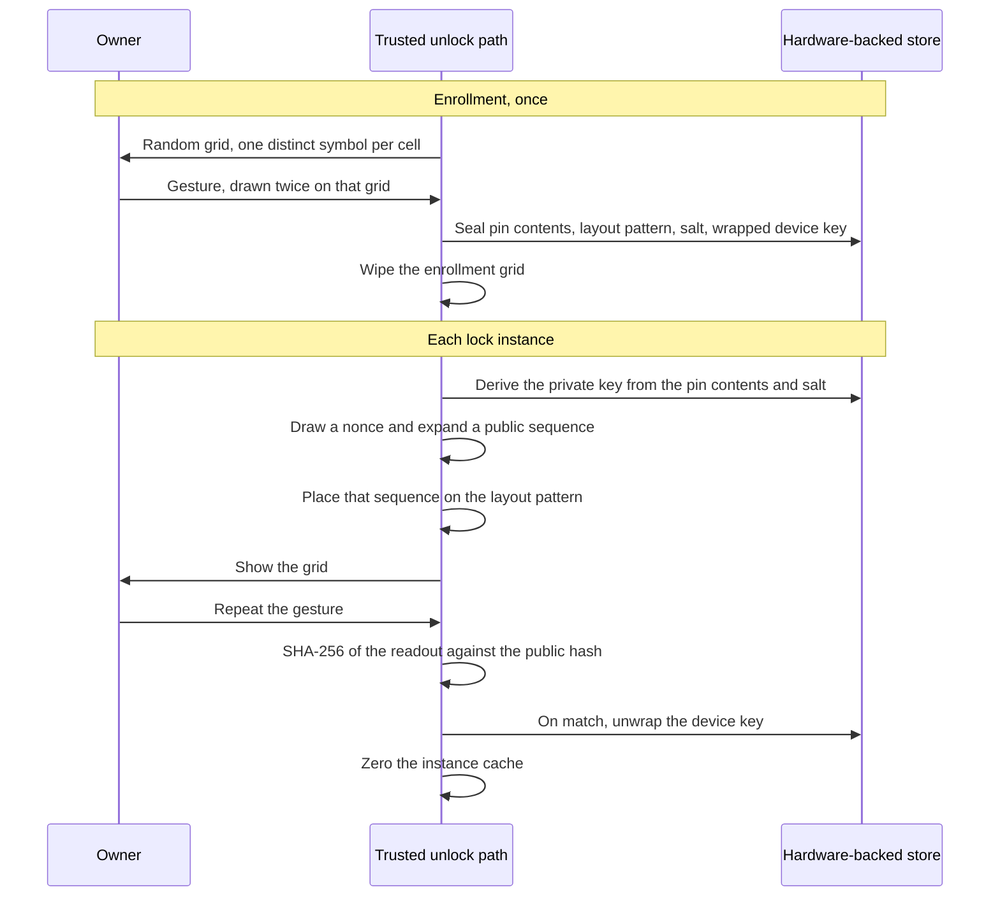

# Pattern Pin

Pattern Pin is a device-unlock specification. The owner remembers a gesture. The device remembers the symbols that gesture crossed at enrollment and uses those symbols as the seed of a private key. Every later presentation of the lock expands that private key into a new public pin sequence, lays the sequence on the same gesture, and accepts the attempt when the hash of the symbols the gesture reads matches the public hash for that presentation.

This repository is the specification. It does not contain a phone implementation, a library, or a reference verifier.

The normative text is [`PatternPin.tex`](PatternPin.tex). [`PatternPin.pdf`](PatternPin.pdf) is the built paper. If the two disagree, the TeX source is the one to change and rebuild.

## Model

A pattern lock repeats a path on a fixed grid. A PIN lock repeats a string on a fixed keypad. Pattern Pin keeps the path as the thing the owner remembers, and changes the symbols under that path every time the lock is shown.

The owner does not memorize symbols. Enrollment samples them once, in order to create the pin contents. Each unlock shows a different covering, derived for that lock instance, and discards it with the instance.



## Two stored values

The sealed record holds two long-term sequences, and they do different jobs.

| Value | What it is | What it is for |
| --- | --- | --- |
| Pin contents | The ordered symbols under the gesture at enrollment | Argon2id input. This generates the private key. |
| Layout pattern | The ordered cell numbers of that gesture | Placement. Each new public sequence is written onto these cells, in order. |

Cell numbers are not the Argon2id input. A match of cell numbers is not success. Success is one digest comparison, defined below.

The private key is a 32-byte seed derived when a lock instance starts. It does not have to be stored between instances. The working copy is cleared when the instance ends. The key is not displayed, and it is not written onto the grid.

## Enrollment

1. The owner chooses a 3×3 grid (9 cells) or a 4×4 grid (16 cells). That size is fixed for the life of the record.
2. The trusted path samples `n` distinct alphabet symbols without replacement and shows one per cell. This covering is random. It is not a function of a key.
3. The owner draws a continuous stroke. The stroke becomes a pattern of distinct cells under the pass-over rule below. Fewer than four cells is rejected.
4. The owner draws it again on the same covering. The two canonical symbol strings must be equal. A mismatch discards the pair and confirmation starts over on the same grid. Abandoning enrollment wipes the grid and stores nothing.
5. On confirmation the trusted path stores the layout pattern and the pin contents, draws a 16-byte salt, derives the private key, draws a 32-byte device key, and wraps that device key under the private key with AES-256-GCM.
6. The enrollment covering, the plaintext device key, and the working private key are wiped.

The GCM additional data binds the wrap to the record: version `1`, grid size, salt, pattern length, layout-pattern cell numbers, and pin-content indexes, in that order. Multi-byte integers in the record are big-endian.

The record lives in hardware-backed storage. Ordinary applications do not receive the pin contents, the private key, the salt, the layout pattern, or the unwrapped device key.

## Pass-over rule

Cells are numbered from 1, row-major, left to right, top to bottom. Cell `c` has column `(c - 1) mod sqrt(n)` and row `floor((c - 1) / sqrt(n))`, with row 0 at the top.

A step from cell `A` to cell `B` uses `g = gcd(|dx|, |dy|)`. The lattice points at `i / g` of the way, for `i = 1 .. g`, are visited in order. A cell is appended only when it is not already in the pattern. A straight step that crosses a cell center includes that cell. An already included center is not added again, and the stroke may continue across it.

## Alphabet

There are 110 symbols. The canonical encoding of an ordered string is the concatenation of these indexes, one byte each, with no separator and no length prefix. Enrollment, public-sequence generation, and verification all use that encoding.

| Indexes | Symbols |
| --- | --- |
| 0–9 | `0`–`9` |
| 10–35 | `A`–`Z` |
| 36–61 | `a`–`z` |
| 62–85 | Greek capitals `U+0391`–`U+03A9` in code-point order, excluding unassigned `U+03A2` |
| 86–109 | Greek small letters `U+03B1`–`U+03C9` in code-point order, excluding final sigma `U+03C2` |

## Lock instance

An instance begins when the lock must be shown and the attempt policy allows a nonce. It ends when the display turns off, the lock is dismissed, or a successful match has released the device key. While the display stays on and the attempt has not succeeded, the nonce and the public hash stay put, including across a wrong stroke.

1. Draw a 32-byte nonce from the CSPRNG. It exists only in the instance cache.
2. Derive the private key from the sealed pin contents and salt.
3. Expand a symbol stream with HKDF-SHA-256 ([RFC 5869](https://www.rfc-editor.org/rfc/rfc5869)). The input keying material is the private key. The salt is the nonce. The info string is the ASCII bytes of `pattern-pin/public-grid/v1`.
4. Turn the stream into unbiased indexes. For each byte `b`, if `b < 220` emit `b mod 110`; otherwise discard `b`. The bound `220 = 2 × 110` removes modulo bias.
5. The first `k` emitted indexes are the public sequence, where `k` is the pattern length. Duplicates are allowed. The public hash is SHA-256 of that canonical byte string.
6. Write public symbol `i` onto layout-pattern cell `i`. Fill every other cell, in row-major order, from the same stream, skipping any index that appears in the public sequence. Those cells are decoys.
7. Show the grid. The owner sees symbols. The nonce, the private key, the public sequence, and the public hash stay in the trusted path.

The grid is a function of the private key, the nonce, and the layout pattern. There is no second random source. Turning the display off destroys the nonce, so the next presentation expands a different public sequence and a different public hash.

The digest is taken over the sequence the gesture can reproduce. The construction generates that sequence from the private key and then hashes it. It does not search for a symbol string that matches a pre-chosen digest.

## Verification and release

The verifier interprets the new stroke with the pass-over rule, on the grid that is showing. It reads the symbols currently displayed on those cells, in stroke order. It does not substitute the stored layout pattern and hash that.

SHA-256 of the canonical readout is compared, in constant time, with the instance's public hash. Both sides are 32 bytes.

A match authorizes one use of the private key: AES-256-GCM unwrap of the device key, tag check included. The plaintext device key is passed to the operating system's unlock function. The private key is not passed out.

The instance cache is then overwritten with zeros: nonce, public sequence, public hash, symbol stream, presented grid, working private key, and plaintext device key in the verifier. The sealed pin contents, layout pattern, salt, and wrapped device key remain. The failure counter is set to 0.

The same wipe runs when the display turns off or the lock is dismissed, except the failure counter is left unchanged and the device key is not unwrapped.

## Attempt policy

The failure counter is inside the sealed record. Display-off does not clear it. Only a successful release sets it to 0.

Let `c` be the counter after a failed comparison. The next stroke in the live instance, or the minting of a nonce for the next instance, waits `d` seconds:

```text
d = 0                              if c < 5
d = min(3600, 30 * 2^(c - 5))      if c >= 5
```

Five failures proceed immediately. The delay is then 30 seconds and doubles until it reaches one hour. The public hash changes only when the instance is wiped and a later instance mints a new nonce.

## What an instance resists

These properties follow from the construction. They are the threat model the specification meets.

- A recorded public sequence compares equal only to the public hash beside the live nonce. After the display turns off, or after a successful unlock, replaying that symbol string fails.
- A picture of the grid is HKDF output. It does not yield the private key, and Argon2id does not yield the pin contents from the private key.
- The symbols on the glass are an instance covering. They are not a standing PIN and they are not the sealed pin contents.
- An online guess is a guess of a stroke. The failure counter survives screen-off, so cycling the display does not refresh the attempt budget. The alphabet makes each public reading one-time. It does not add a second secret the owner must remember.
- A match authorizes one unwrap. The seed used for that unwrap is cleared from working memory with the instance.

Exposures that follow from the same construction:

- The gesture is durable. Each new grid is built so that the stored pattern reads the new public sequence. A person who learns the stroke, from watching the hand, from a recording, or from a smudge of the path, can draw it on the next grid.
- A party who can read the hardware-backed record obtains the pin contents and the layout pattern and can derive the private key. The specification assumes ordinary software cannot read that store.
- The component that draws the grid is inside the trusted unlock path, the same trust placed in the component that reads a PIN. The instance cache is still wiped when the display turns off.

## Parameters

| Parameter | Value |
| --- | --- |
| Grid | 9 or 16 cells, one symbol each, fixed at enrollment |
| Pattern length | 4 through `n` distinct cells |
| Private key | Argon2id, 32 bytes, `m = 65536` KiB, `t = 3`, `p = 4`, version `0x13` ([RFC 9106](https://www.rfc-editor.org/rfc/rfc9106) low-memory parameters) |
| Salt | 16 bytes |
| Nonce | 32 bytes, one lock instance |
| Public expansion | HKDF-SHA-256, info `pattern-pin/public-grid/v1` |
| Index sampling | Accept byte `b` when `b < 220`, emit `b mod 110` |
| Public hash | SHA-256 of the canonical public sequence |
| Check | Constant-time equality of the two 32-byte digests |
| Device-key wrap | AES-256-GCM, 12-byte nonce, 16-byte tag ([NIST SP 800-38D](https://csrc.nist.gov/pubs/sp/800/38/d/final)) |
| Free failures | 5, then 30 seconds doubling to a cap of 3600 seconds |

Section 12 of the paper walks a 3×3 example. The enrollment readout `κ 7 Δ R ω` is the byte string `5f 07 41 1b 6d`. An illustrated public sequence `4 σ a Z 9` is the byte string `04 67 24 23 09`, whose SHA-256 is `2da679a4f9135590f8b49b82ee1b728a536fa7c25375fbcd3cf3ab05b8c386e0`. The figure is an illustration of placement. A deployed instance replaces both coverings with a real sample and a real HKDF output.

## Build the paper

The build needs a current TeX Live with `geometry`, `microtype`, `amsmath`, `amssymb`, `booktabs`, `enumitem`, `xcolor`, `tikz`, and `hyperref`.

```sh
pdflatex PatternPin.tex
pdflatex PatternPin.tex
```

The second pass fills the table of contents and the cross-references.

## Boundaries

Replacing a forgotten gesture is a new enrollment, which replaces the sealed record. This specification does not define a recovery channel. Shared locks, remote unlock, and a biometric combined with the gesture are outside this version. The only grid sizes defined here are 3×3 and 4×4.
